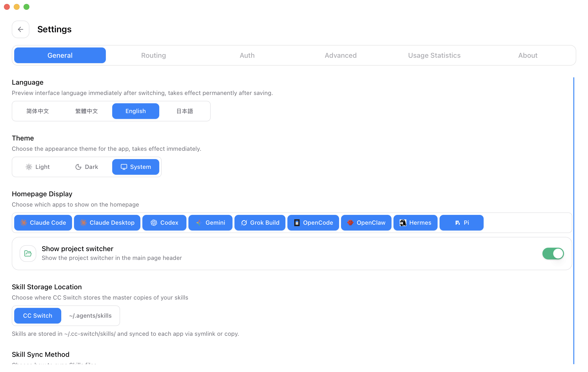
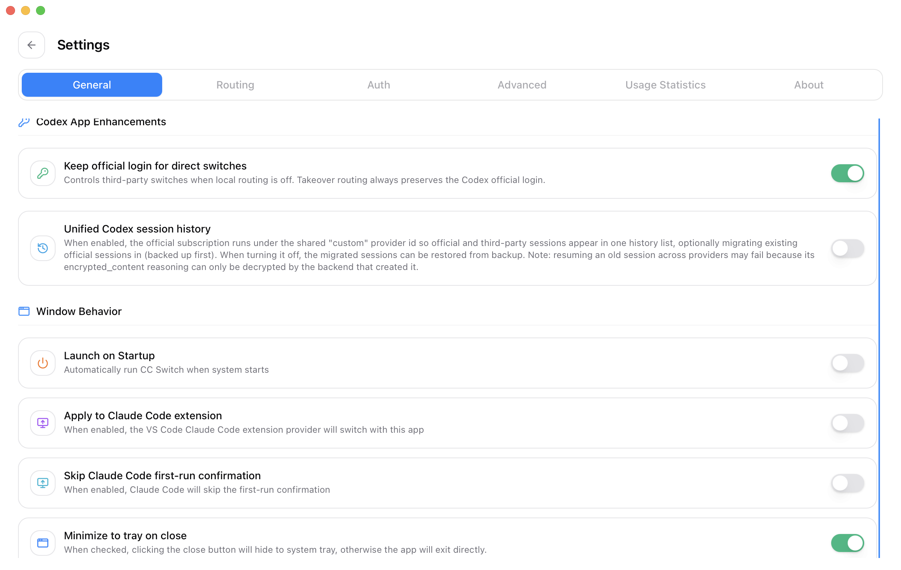
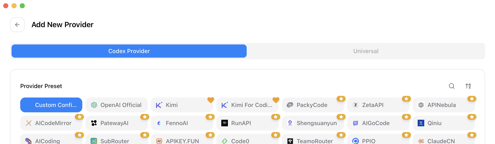
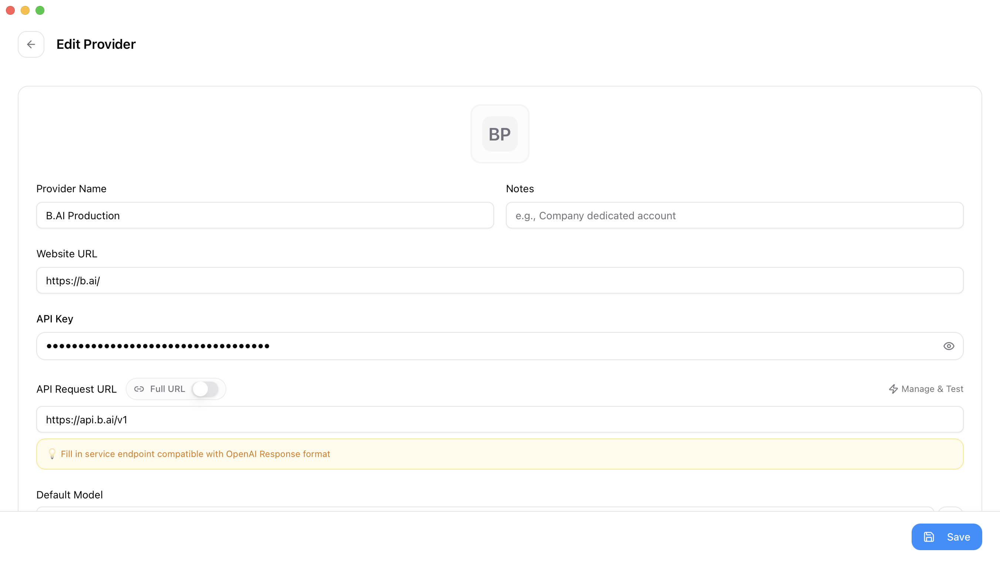
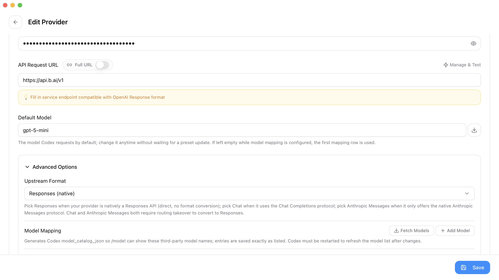
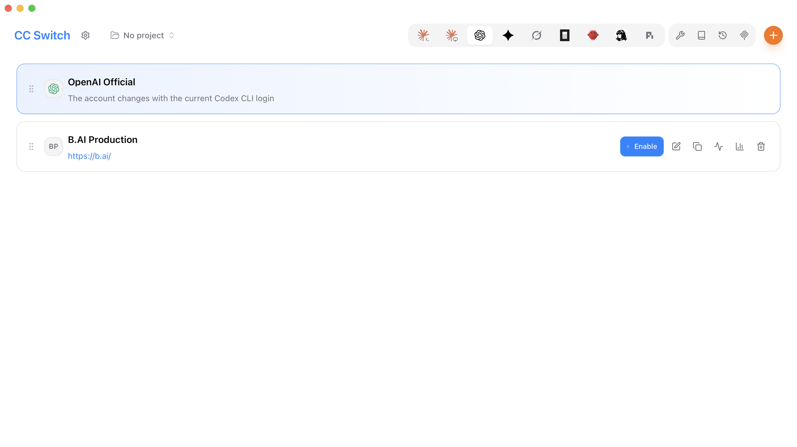
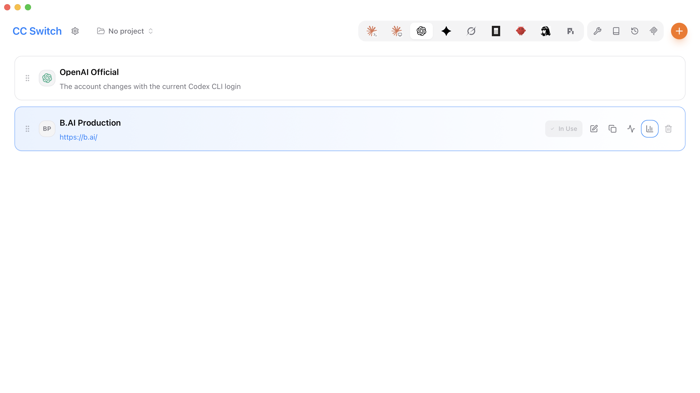
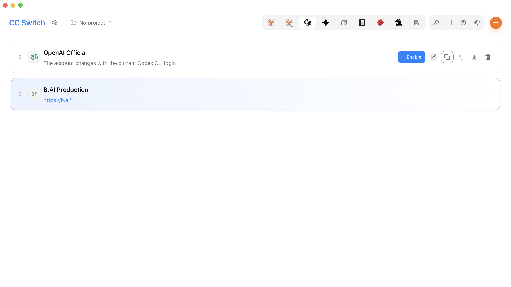

# How to Connect B.AI to Codex with CC Switch: Step-by-Step Visual Guide

This guide explains how to use a B.AI API key in Codex through CC Switch. After setup, Codex sends model requests to the B.AI Responses API.

- **Production API URL:** `https://api.b.ai/v1`
- **Upstream format:** `Responses (native)`
- **Recommended first model:** A GPT model returned by **Fetch Models**
- **Screenshots:** CC Switch 3.20.0 on macOS

> Menu names may differ slightly in later CC Switch releases. The required B.AI endpoint and Responses protocol remain the same.
>
> Screenshots may show an example model ID. Select a currently available model through **Fetch Models** rather than relying on the example.

## Before you begin

Make sure that you have:

1. Installed Codex and completed the initial sign-in;
2. Installed CC Switch from its trusted release channel;
3. Created a valid B.AI production API key;
4. Confirmed that your B.AI account has access to the model you want to use and has sufficient balance.

Treat your API key as a password. Never include it in screenshots, chat messages, support tickets, source code, or public repositories.

## 1. Use the English interface

In CC Switch, open **Settings > General** and select **English** under **Language**.



## 2. Keep the official Codex login

If you want to switch between B.AI and OpenAI Official, open **Settings > General** and enable **Keep official login for direct switches** under **Codex App Enhancements**.



When this option is enabled, Codex may continue to show your signed-in OpenAI account while B.AI is active. This is expected. The provider marked **In Use** in CC Switch determines where model requests are sent.

## 3. Add a Codex provider

Return to the CC Switch home page, select **Codex** in the application bar, and click the orange **+** button.

Under **Codex Provider**, select **Custom Configuration**.



## 4. Enter the B.AI production settings

Complete the provider form with the following values:

| Field | Value |
| --- | --- |
| Provider Name | `B.AI Production` |
| Website URL | `https://b.ai/` |
| API Key | Your B.AI production API key |
| API Request URL | `https://api.b.ai/v1` |
| Full URL | Off |
| Default Model | A GPT model returned by **Fetch Models** |



The API key is masked after entry. Do not select the eye icon before taking a screenshot or sharing your screen. CC Switch may also show the key in the generated `auth.json` preview farther down the editor, so keep that section out of screenshots.

## 5. Select the native Responses protocol

Expand **Advanced Options** and set **Upstream Format** to **Responses (native)**.



B.AI supports the Responses API natively. Local routing or protocol conversion is not required for this provider.

Click **Fetch Models** to check the production URL, API key, and account access. A successful result confirms that CC Switch can reach B.AI. The number of returned models may change as the platform is updated.

## 6. Save and enable B.AI

Click **Save**. Back on the Codex provider page, locate **B.AI Production** and click **Enable**.



The B.AI Production card becomes highlighted and displays **In Use** when the switch succeeds.



CC Switch generates the Codex configuration automatically. The effective configuration is equivalent to:

```toml
model_provider = "custom"
model = "your-model-id"

[model_providers.custom]
name = "custom"
wire_api = "responses"
requires_openai_auth = true
base_url = "https://api.b.ai/v1"
```

CC Switch manages the API key separately. Do not place a real key in documentation, project source code, or a committed `config.toml` file.

## 7. Restart and verify Codex

Completely quit and reopen Codex, or start a new Codex CLI session. This ensures that the provider configuration and model catalog are reloaded.

Send the following test prompt:

```text
Reply with exactly: B.AI Codex connection successful
```

If Codex returns the requested text, the connection is working. You can also check the B.AI usage page to confirm that the request was processed by B.AI.

The production environment was validated using **Fetch Models**, non-streaming Responses, SSE streaming Responses, and an end-to-end Codex request.

## 8. Change the model

For the first connection, select a GPT model returned by **Fetch Models**. After it works, edit the provider and select another available model.

B.AI Responses API supports GPT and DeepSeek model families. This guide does not maintain a fixed model ID list because model availability depends on the B.AI account, balance, and Codex version. B.AI Responses API support does not guarantee compatibility with every Codex release; verify the selected model with the installed Codex version.

### Use a DeepSeek model

:::caution Disable Codex web search before using DeepSeek
Codex may expose its built-in web search tool by default, but DeepSeek models do not support that tool. Without this setting, the request may return an unsupported Web Search tool error.

After selecting a DeepSeek model, open `~/.codex/config.toml` and add this top-level option:

```toml
web_search = "disabled"
```

Keep the option above and outside the `[model_providers.custom]` block. Save the file, fully quit Codex, and restart it. This setting is required when using DeepSeek; remove or change it when switching to a model configuration that uses web search.
:::

## 9. Switch back to OpenAI Official

To restore the official Codex provider, locate **OpenAI Official** and click **Enable**.



The OpenAI Official card becomes highlighted after the switch.


For Codex CLI, you can check the login state with:

```bash
codex login status
```

A signed-in official account normally returns:

```text
Logged in using ChatGPT
```

## Troubleshooting

| Issue | What to check |
| --- | --- |
| Models cannot be fetched | Confirm that the URL is `https://api.b.ai/v1`, the production key is valid, and the account has available balance. |
| `401 Unauthorized` | The API key is missing, invalid, or belongs to a different environment. Make sure you are not using a staging key. |
| `403 Forbidden` | Check the account status, balance, and model access. |
| Model not found | Use the exact model ID returned by **Fetch Models** and confirm that the model supports Responses. |
| DeepSeek request reports an unsupported web search tool | Add the top-level `web_search = "disabled"` setting to `~/.codex/config.toml`, then restart Codex. |
| Codex still uses the previous provider | Confirm that the intended provider is highlighted in CC Switch, then fully restart Codex. |
| Codex still shows the official account | This is expected when **Keep official login for direct switches** is enabled. Check the active provider in CC Switch. |

## Security recommendations

- Download CC Switch only from a trusted release source;
- Use separate API keys for different projects or environments;
- Rotate keys regularly and revoke a key immediately if it may have been exposed;
- Never copy, share, or manually edit `~/.codex/auth.json`;
- Keep API keys out of screenshots, logs, public repositories, and client installers.

## Related documentation

- [B.AI documentation](https://docs.b.ai/)
- [CC Switch repository](https://github.com/farion1231/cc-switch)
- [Codex configuration reference](https://developers.openai.com/codex/config-reference/)
