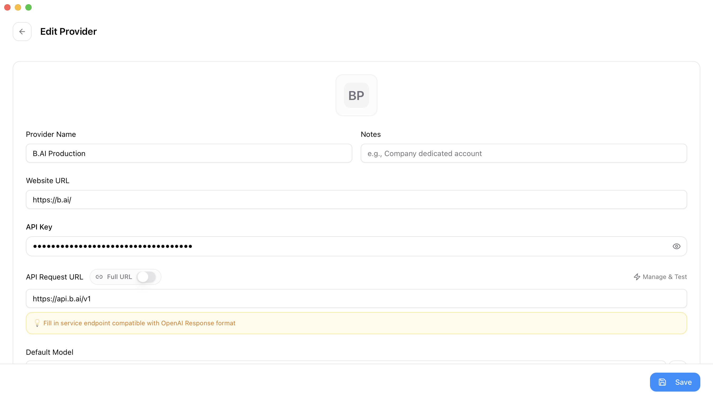
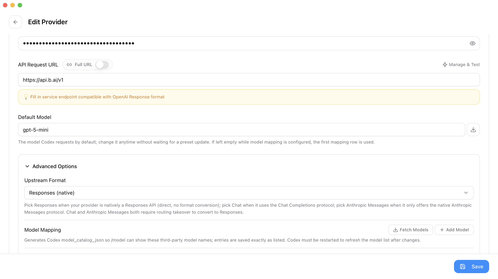
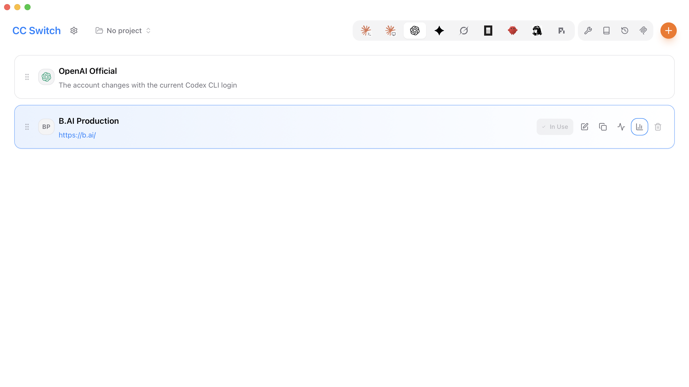

# Configure B.AI with CC Switch and Generate Seedance Videos in Codex

After configuring B.AI, describe the video you want to Codex and let it handle API requests, waiting, and downloads. You do not need to write the code yourself.

## Before You Begin

- Install and sign in to Codex CLI using the [official OpenAI documentation](https://learn.chatgpt.com/docs/cli).
- Install [CC Switch](https://github.com/farion1231/cc-switch/releases).
- Create an API Key in the [B.AI console](https://chat.b.ai/key) and confirm that your account has available balance and access to the required models.
- Create a folder for your video. The launcher in this guide requires Python 3 on your computer.

> **Fees:** B.AI text model requests and Seedance video generation are billed separately. Confirm the charges before generating a video, and do not submit the same task repeatedly.

## 1. Configure B.AI in CC Switch

Open CC Switch, select **Codex → Add Provider → Custom Configuration**, and enter:

| Setting | Value |
| --- | --- |
| Provider Name | `B.AI` |
| API Key | Your B.AI Key |
| API Request URL | `https://api.b.ai/v1` |
| Full URL | Off |
| Upstream Format | `Responses (native)` |
| Default Model | Click **Fetch Models** and select a currently available GPT model compatible with Codex |



*Enter the Key and request URL, keeping the Key hidden. The configuration preview may also contain the full Key; do not share it in screenshots.*



*Select Responses (native) and choose a model from the current results. The model in the screenshot is only an example.*

Click **Save**, return to the provider list, click **Enable** for B.AI, and confirm that it shows **In Use**.



The GPT model selected here interprets your instructions. **Specify Seedance later in your video request.** Interface labels may vary slightly; use the corresponding settings.

## 2. Start Codex and Provide Access for Video Requests

The Key in CC Switch is used for Codex conversations. Video requests also need access to a Key. You can use the same Key without creating another one.

Download the <a href="pathname:///downloads/codex/start_codex.py" autoAddBaseUrl={false} download="start_codex.py" target="_self">start_codex.py launcher</a> and place it in your video folder. Fully quit any running Codex instance, open a terminal in that folder, and run:

**macOS / Linux:**

```bash
python3 start_codex.py
```

**Windows PowerShell:**

```powershell
py -3 start_codex.py
```

Paste your B.AI Key at the prompt and press Enter. Your input is not displayed. The launcher starts Codex and provides the Key to this session without writing it to a file. Use the same command whenever you start a new session.

> Enter the Key only in the CC Switch Key field and the local hidden-input prompt. Never put a real Key in chat, code, or screenshots. If the download is unavailable, expand the launcher code at the end of this guide.

## 3. Describe the Video You Want

After Codex starts, paste the following prompt. You can change the video description:

```text
Please use the official B.AI documentation to help me generate a Seedance video:
https://docs.b.ai/llmservice/api/videos/

Video: A beach at sunrise, gentle waves washing onto the sand, soft sunlight,
a fixed camera, and no subtitles.
Use seedance-2.0-mini, 4 seconds, 480p, 16:9, with no audio.

Check the runtime environment, model access, and currently supported parameters,
and prepare the calling program yourself.
The Key is available in the BAI_API_KEY environment variable. Do not display or
save it, and do not extract it from Codex credential files.

If anything is missing or you cannot read the official documentation, tell me.
Do not guess or automatically substitute another model.
First explain whether everything is ready and that generation incurs API fees.
Do not submit the task yet.
```

Codex checks the environment and prepares the API call. You do not need to read or manually execute the code it writes.

## 4. Confirm Generation and Wait for the Download

After confirming the requirements and fees, paste:

```text
I understand that this video generation incurs B.AI API fees. Please proceed.
Create only one task, save its task ID, query its progress automatically, and
download the video after generation and billing settlement are complete.
Save the video in the current folder and tell me its file path when finished.
If it fails, times out, or billing requires review, keep the original task and
tell me. Do not automatically generate another video.
```

Wait for Codex to finish. Open the resulting file to check the video and keep a backup.


*A frame from a beach video generated with B.AI Seedance. Actual results may vary.*

If a problem occurs, tell Codex:

```text
Please check the current task and keep its existing task ID. Do not generate
another video or output the Key. Tell me the current status and what I need to do.
```

<details>
<summary>Launcher Code (Only Needed if the Download Is Unavailable)</summary>

Save the code below as `start_codex.py` in your video folder. Make sure the extension is `.py`, not `.py.txt`. Enter the real Key only at the hidden-input prompt when you run it.

```python
"""Read B.AI Key without echoing it, then start Codex in this folder."""
import getpass
import os
from pathlib import Path
import shutil
import subprocess
import sys

os.chdir(Path(__file__).resolve().parent)
if not shutil.which("codex"):
    sys.exit("找不到 codex 命令，请先按 OpenAI 官方文档安装 Codex CLI。")
key = getpass.getpass("B.AI API Key（隐藏输入）: ").strip()
if not key:
    sys.exit("未输入 Key，已停止。")
env = os.environ.copy()
env["BAI_API_KEY"] = key
sys.exit(subprocess.call(["codex"], env=env))
```

</details>

## Related Documentation

- [Connect Codex with B.AI API](./integration-guide.md)
- [CC Switch Codex Visual Guide](./cc-switch-production-guide.md)
- [Video Generation API](../api/videos.md)
- [Video Generation Model Pricing](../video-models/pricing.md)
