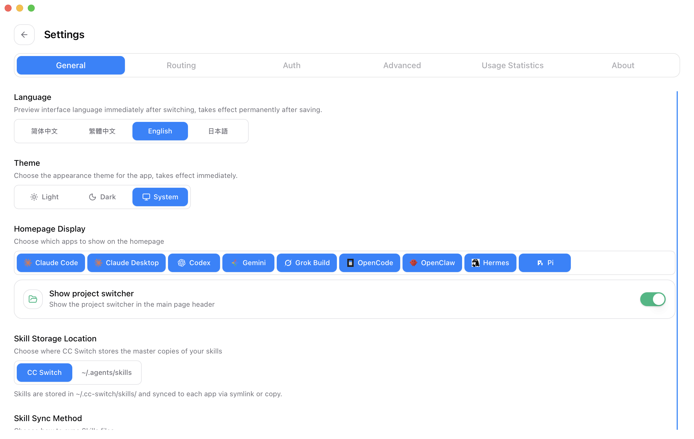
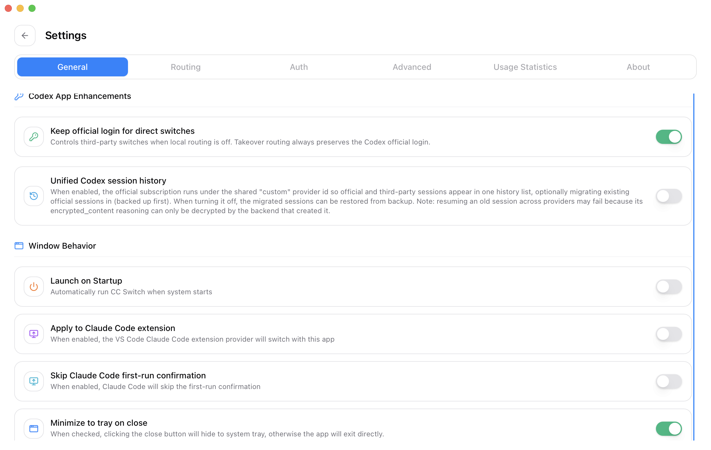
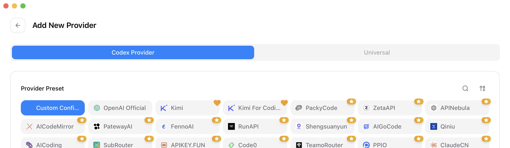
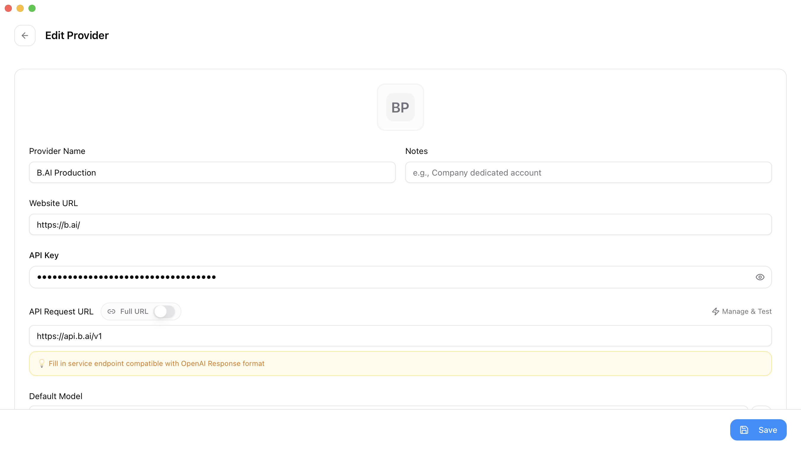
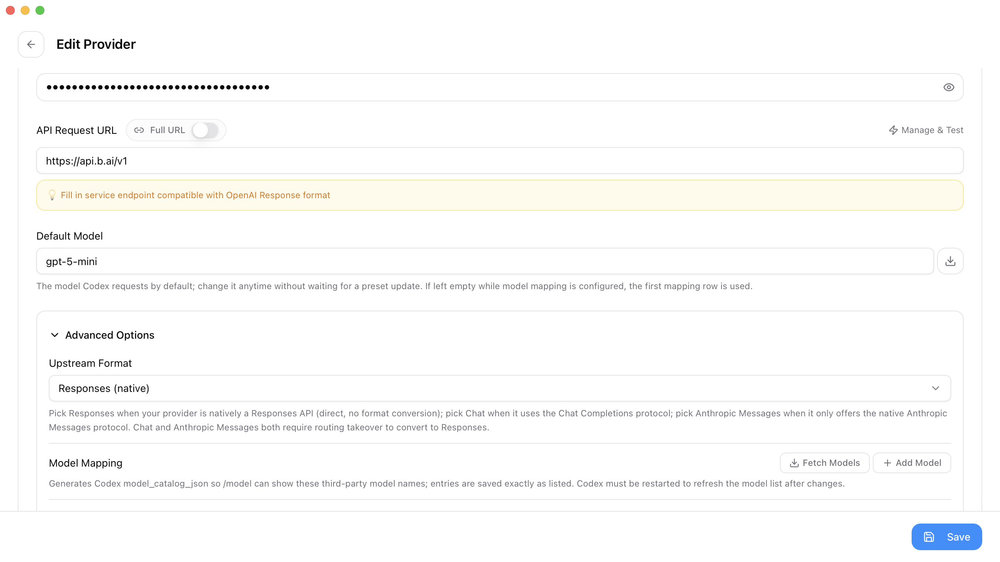
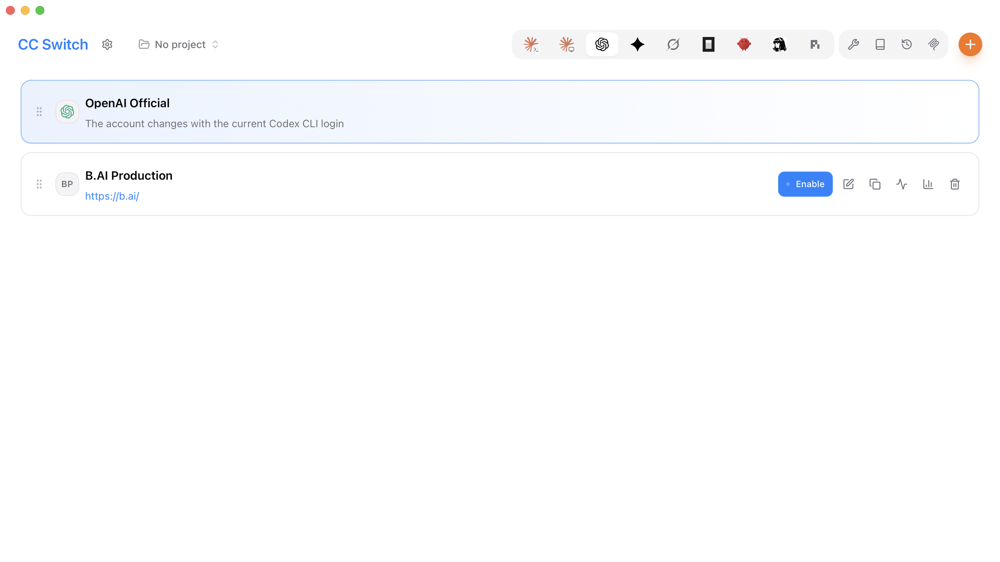
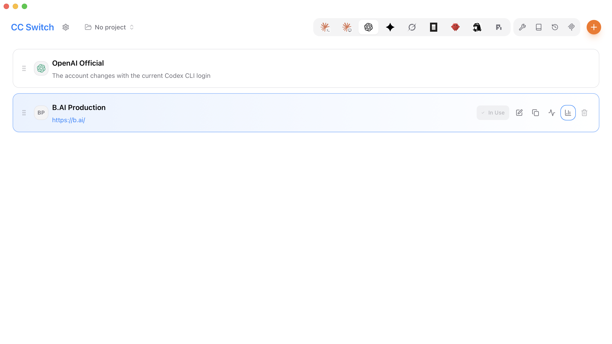
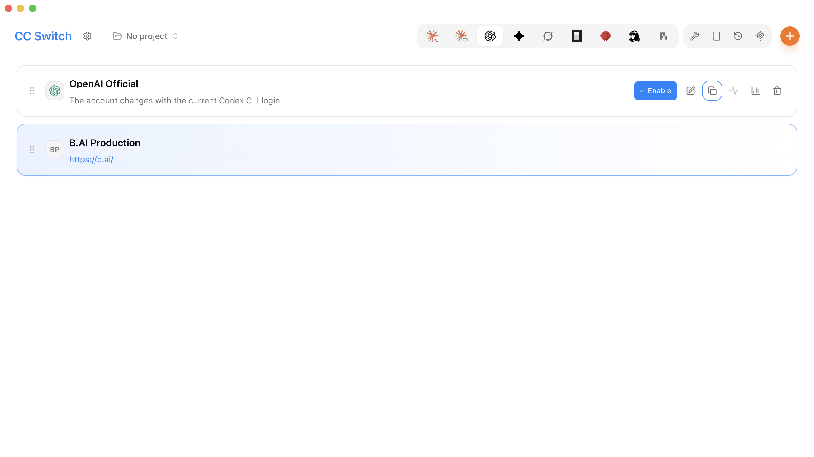

# 如何通过 CC Switch 将 B.AI 接入 Codex？图文操作教程

本文介绍如何通过 CC Switch 在 Codex 中使用 B.AI API Key。完成配置后，Codex 将通过 B.AI Responses API 发起模型请求。

- **生产 API 地址：** `https://api.b.ai/v1`
- **上游格式：** `Responses (native)`
- **建议首次使用的模型：** **Fetch Models** 返回的 GPT 模型
- **截图版本：** macOS 上的 CC Switch 3.20.0

> 后续 CC Switch 版本中的菜单名称可能略有不同，但 B.AI API 地址和 Responses 协议保持不变。
>
> 截图中可能出现示例模型 ID。配置时请通过 **Fetch Models** 选择当前可用模型，不要将截图中的示例作为固定清单。

## 开始前准备

请确认你已经：

1. 安装 Codex 并完成首次登录；
2. 从可信发布渠道安装 CC Switch；
3. 创建有效的 B.AI 生产 API Key；
4. 确认 B.AI 账户具有所需模型的访问权限和足够余额。

请将 API Key 视为密码。不要在截图、聊天消息、支持工单、源代码或公开仓库中泄露它。

## 1. 使用中文界面

在 CC Switch 中打开 **Settings > General**，在 **Language** 下选择中文。本文截图使用英文界面展示；切换为中文后，配置位置和操作顺序一致，按对应中文字段操作即可。



## 2. 保留 Codex 官方登录

如果需要在 B.AI 和 OpenAI Official 之间切换，请打开 **Settings > General**，在 **Codex App Enhancements** 中启用 **Keep official login for direct switches**。



启用后，即使 B.AI 已生效，Codex 仍可能继续显示已登录的 OpenAI 账号，这是正常现象。CC Switch 中标记为 **In Use** 的供应商决定模型请求实际发送至何处。

## 3. 添加 Codex 供应商

返回 CC Switch 首页，在应用栏中选择 **Codex**，然后点击橙色 **+** 按钮。

在 **Codex Provider** 下选择 **Custom Configuration**。



## 4. 填写 B.AI 生产环境配置

请按下表填写供应商配置：

| 字段 | 配置值 |
| --- | --- |
| Provider Name | `B.AI Production` |
| Website URL | `https://b.ai/` |
| API Key | 你的 B.AI 生产 API Key |
| API Request URL | `https://api.b.ai/v1` |
| Full URL | 关闭 |
| Default Model | **Fetch Models** 返回的 GPT 模型 |



API Key 输入后会被遮挡。截图或共享屏幕前不要点击眼睛图标。CC Switch 还可能在编辑器下方生成的 `auth.json` 预览中显示 API Key，因此请勿将该区域包含在截图中。

## 5. 选择原生 Responses 协议

展开 **Advanced Options**，将 **Upstream Format** 设置为 **Responses (native)**。



B.AI 原生支持 Responses API，此供应商不需要本地路由或协议转换。

点击 **Fetch Models**，检查生产地址、API Key 和账户访问权限。成功返回表示 CC Switch 已可访问 B.AI；模型数量会随着平台更新而变化。

## 6. 保存并启用 B.AI

点击 **Save**。返回 Codex 供应商页面后，找到 **B.AI Production** 并点击 **Enable**。



切换成功后，B.AI Production 卡片会高亮并显示 **In Use**。



CC Switch 会自动生成 Codex 配置。等效配置如下：

```toml
model_provider = "custom"
model = "your-model-id"

[model_providers.custom]
name = "custom"
wire_api = "responses"
requires_openai_auth = true
base_url = "https://api.b.ai/v1"
```

CC Switch 会单独管理 API Key。请勿将真实 Key 写入文档、项目源代码或提交到版本控制的 `config.toml` 文件中。

## 7. 重启并验证 Codex

完全退出并重新打开 Codex，或启动新的 Codex CLI 会话，以重新加载供应商配置和模型列表。

输入以下测试提示：

```text
请严格回复：B.AI Codex connection successful
```

如果 Codex 返回指定文本，说明连接正常。你也可以在 B.AI 用量页面确认该请求已由 B.AI 处理。

生产环境已完成模型获取、非流式 Responses、SSE 流式 Responses 以及端到端 Codex 请求验证。

## 8. 切换模型

首次连接建议选择 **Fetch Models** 返回的 GPT 模型。验证成功后，可以编辑供应商配置并选择其他可用模型。

B.AI Responses API 支持 GPT 与 DeepSeek 模型系列。本文不维护固定的模型 ID 清单；模型可用性取决于 B.AI 账户、余额和 Codex 版本。B.AI Responses API 支持并不代表每个模型都兼容所有 Codex 版本，请在当前安装的 Codex 版本中验证所选模型。

### 在 Codex 中使用 DeepSeek 模型

:::caution 使用 DeepSeek 前必须关闭 Codex 联网搜索
Codex 默认可能启用内置联网搜索工具，但 DeepSeek 模型不支持该工具。如果没有关闭，请求可能返回“不支持 Web Search 工具”的错误。

选择 DeepSeek 模型后，请打开 `~/.codex/config.toml`，增加以下顶层配置：

```toml
web_search = "disabled"
```

请将该配置放在 `[model_providers.custom]` 配置块上方和配置块之外。保存文件后，完全退出并重新启动 Codex。该设置是使用 DeepSeek 时的必要配置；切换到需要联网搜索的模型配置时，应删除或调整此项。
:::

## 9. 切回 OpenAI Official

如需恢复 Codex 官方供应商，找到 **OpenAI Official** 并点击 **Enable**。



切换后，OpenAI Official 卡片会高亮。


对于 Codex CLI，可以使用以下命令检查登录状态：

```bash
codex login status
```

已登录的官方账号通常会返回：

```text
Logged in using ChatGPT
```

## 故障排查

| 问题 | 检查项 |
| --- | --- |
| 无法获取模型 | 确认地址为 `https://api.b.ai/v1`、生产 Key 有效且账户余额充足。 |
| `401 Unauthorized` | API Key 缺失、无效或属于其他环境。请确认使用的是生产 Key。 |
| `403 Forbidden` | 检查账户状态、余额和模型访问权限。 |
| 找不到模型 | 使用 **Fetch Models** 返回的准确模型 ID，并确认该模型支持 Responses。 |
| DeepSeek 请求提示不支持联网搜索工具 | 在 `~/.codex/config.toml` 中增加顶层配置 `web_search = "disabled"`，然后重启 Codex。 |
| Codex 仍使用此前供应商 | 确认目标供应商已在 CC Switch 中高亮，然后完全重启 Codex。 |
| Codex 仍显示官方账号 | 启用了 **Keep official login for direct switches** 时属于正常现象；请以 CC Switch 中的当前供应商为准。 |

## 安全建议

- 仅从可信发布来源下载 CC Switch；
- 不同项目或环境使用不同 API Key；
- 定期轮换 API Key，怀疑泄露时立即撤销；
- 不要复制、共享或手动编辑 `~/.codex/auth.json`；
- 不要在截图、日志、公开仓库或客户端安装包中包含 API Key。

## 相关文档

- [B.AI 文档](https://docs.b.ai/)
- [CC Switch 仓库](https://github.com/farion1231/cc-switch)
- [Codex 配置参考](https://developers.openai.com/codex/config-reference/)
