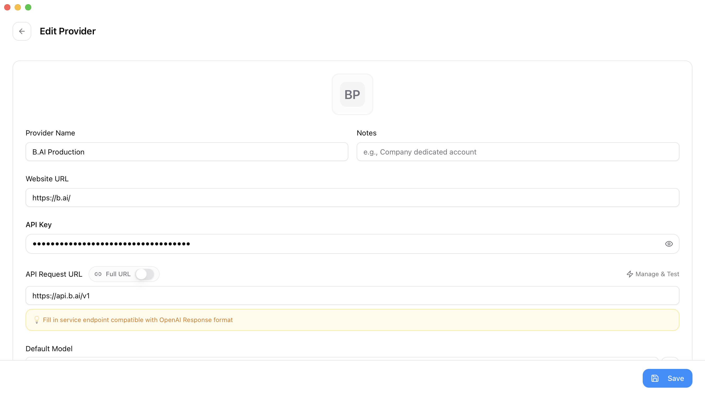
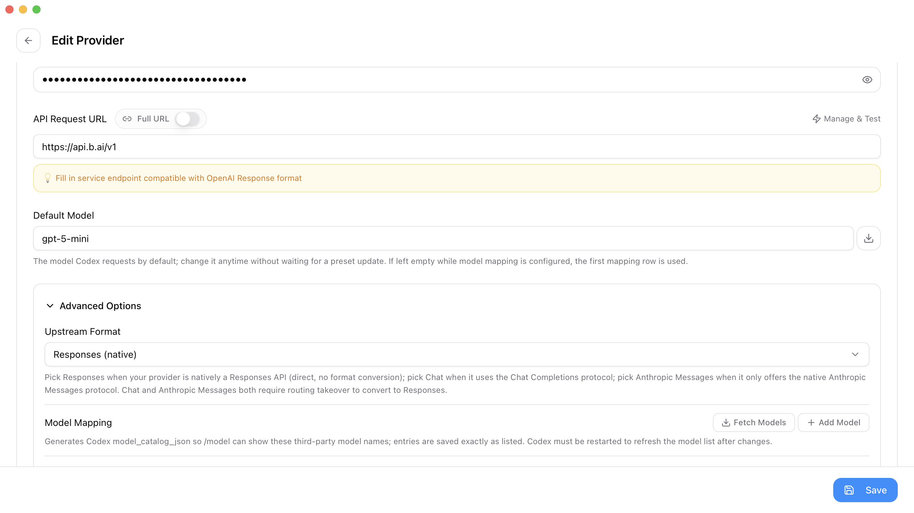
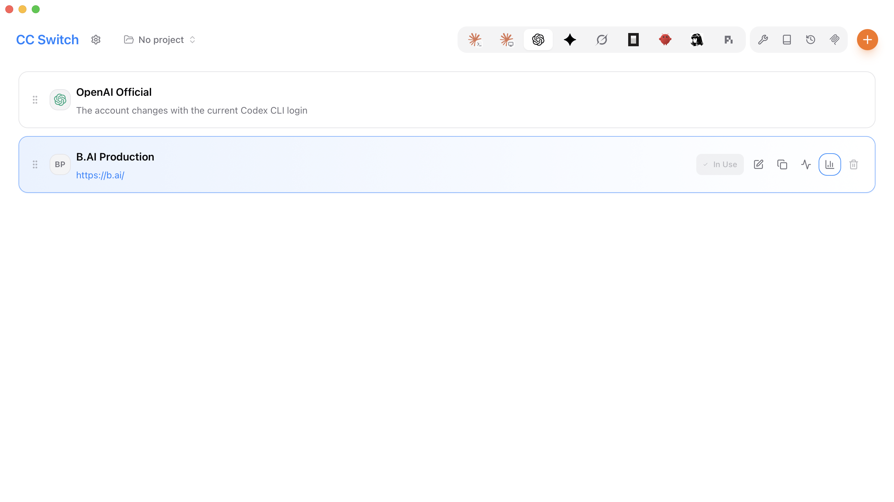

# 用 CC Switch 配置 B.AI，在 Codex 中生成 Seedance 视频

配置好 B.AI 后，你只需告诉 Codex 想要什么视频，让它完成调用、等待和下载，无需自己写代码。

## 开始前准备

- 按 [OpenAI 官方文档](https://learn.chatgpt.com/docs/cli)安装并登录 Codex CLI。
- 安装 [CC Switch](https://github.com/farion1231/cc-switch/releases)。
- 在 [B.AI 控制台](https://chat.b.ai/key)创建 API Key，确认账户有可用余额及所需模型权限。
- 为视频准备一个文件夹。本文的安全启动工具需要本机已安装 Python 3。

> **费用提示：**B.AI 文本模型调用和 Seedance 视频生成分别计费。生成视频前请确认费用；不要重复提交同一个任务。

## 1. 在 CC Switch 中配置 B.AI

打开 CC Switch，选择 **Codex → 添加供应商 → 自定义配置**，填写：

| 配置项 | 填写内容 |
| --- | --- |
| 供应商名称 | `B.AI` |
| API Key | 你的 B.AI Key |
| 请求地址 | `https://api.b.ai/v1` |
| Full URL | 关闭 |
| 上游格式 / Upstream Format | `Responses (native)` |
| 默认模型 / Default Model | 点击 **Fetch Models（获取模型）**，选择当前可用、兼容 Codex 的 GPT 模型 |



*填写 Key 和请求地址，Key 保持隐藏。配置预览也可能包含完整 Key，请勿截图分享。*



*选择 Responses (native)，按实时获取结果选择模型。截图中的模型仅为示例。*

点击 **Save（保存）**，返回列表，对 B.AI 点击 **Enable（启用）**，确认显示 **In Use（使用中）**。



这里选择的 GPT 模型负责理解你的指令；**Seedance 在后面的视频需求中指定**。界面名称可能略有不同，按对应字段操作即可。

## 2. 启动 Codex，授权视频调用

CC Switch 中的 Key 用于 Codex 对话。视频调用还需要读取 Key，可以使用同一枚，无需重新申请。

下载<a href="pathname:///downloads/codex/start_codex.py" autoAddBaseUrl={false} download="start_codex.py" target="_self">安全启动工具 start_codex.py</a>，放进视频文件夹，完全退出正在运行的 Codex，在该文件夹打开终端，运行：

**macOS / Linux：**

```bash
python3 start_codex.py
```

**Windows PowerShell：**

```powershell
py -3 start_codex.py
```

按提示粘贴 B.AI Key，然后按回车。输入不会显示在屏幕上，工具会启动 Codex，并将 Key 提供给本次会话；它不会把 Key 写入文件。以后重新启动时，仍使用这条命令。

> 只在 CC Switch 密钥输入框和本地隐藏输入提示中填写 Key，不要把真实 Key 发到聊天、代码或截图中。无法下载时，也可以从文末展开复制启动工具代码。

## 3. 告诉 Codex 你想生成什么

进入 Codex 后，复制下面的提示词。你可以修改其中的视频描述：

```text
请根据 B.AI 官方文档，帮我生成一段 Seedance 视频：
https://docs.b.ai/llmservice/api/videos/

视频内容：清晨的海边，海浪轻轻拍打沙滩，阳光柔和，固定镜头，无字幕。
本例使用 seedance-2.0-mini，4 秒，480p，16:9，不生成音频。

请检查运行环境、模型权限和当前支持的参数，自行准备调用程序。
Key 已通过 BAI_API_KEY 环境变量提供，不要显示或保存密钥，
不要从 Codex 凭据文件中提取密钥。

如果缺少条件或无法读取官方文档，请告诉我，不要猜测或自动替换模型。
先说明是否准备就绪，以及生成会产生 API 费用，暂不提交。
```

Codex 会完成环境检查和调用准备。你无需阅读或手动执行它编写的代码。

## 4. 确认生成，等待视频下载

确认需求和费用后，复制：

```text
我已知晓本次视频生成会产生 B.AI API 费用，请执行。
只创建一个任务，保存任务 ID，自动查询进度，并在完成及结算后下载视频。
将视频保存到当前文件夹，完成后告诉我文件路径。
如果失败、超时或结算待核对，请保留原任务并告诉我，不要自动重新生成。
```

等待 Codex 完成。收到文件路径后，打开视频检查效果，并及时备份。


*使用 B.AI Seedance 生成的海边视频抽帧，具体效果以实际输出为准。*

如果中途遇到问题，直接对 Codex 说：

```text
请检查当前任务，保留已有任务 ID，不要重新生成，也不要输出密钥。
告诉我目前的情况，以及需要我做什么。
```

<details>
<summary>安全启动工具代码（仅在无法下载时需要）</summary>

将以下代码保存为 `start_codex.py`，放入视频文件夹。注意文件后缀是 `.py`，不是 `.py.txt`。真实 Key 在运行后的隐藏输入提示中填写。

```python
"""Read B.AI Key without echoing it, then start Codex in this folder."""
import getpass
import os
from pathlib import Path
import shutil
import subprocess
import sys

os.chdir(Path(__file__).resolve().parent)
if not shutil.which("codex"):
    sys.exit("找不到 codex 命令，请先按 OpenAI 官方文档安装 Codex CLI。")
key = getpass.getpass("B.AI API Key（隐藏输入）: ").strip()
if not key:
    sys.exit("未输入 Key，已停止。")
env = os.environ.copy()
env["BAI_API_KEY"] = key
sys.exit(subprocess.call(["codex"], env=env))
```

</details>

## 相关文档

- [Codex 接入 B.AI API 配置指南](./integration-guide.md)
- [CC Switch 接入 Codex 图文教程](./cc-switch-production-guide.md)
- [视频生成 API](../api/videos.md)
- [视频生成模型定价](../video-models/pricing.md)
